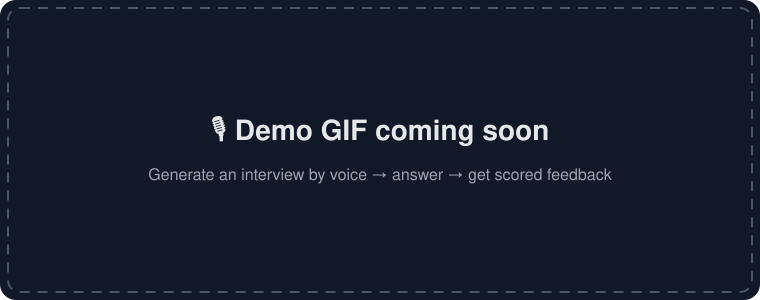
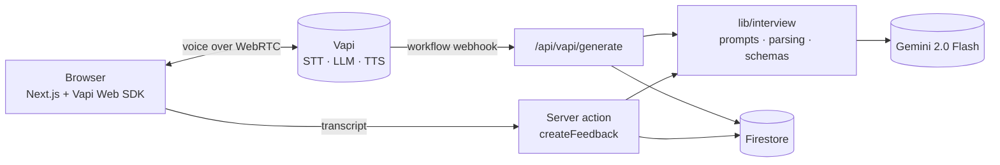

<div align="center">

# 🎙️ AI Voice Interviewer

**Practice job interviews out loud with an AI interviewer, then get scored, written feedback in seconds.**

[](https://github.com/obro79/mock_interview_ai/actions/workflows/ci.yml)
[](LICENSE)


**[Live demo](https://mock-interview-ai-git-main-owens-projects-e5b63a60.vercel.app)**

</div>

<!-- TODO(owen): record a ~20s GIF (generate an interview by voice, answer one question, open the feedback page), save it as docs/media/demo.gif and point the img below at it. -->
<p align="center">
  
</p>

## What it does

- **Builds a custom interview by voice.** Tell the agent the role, seniority, tech stack and how technical you want it. Gemini writes the questions.
- **Runs a real-time spoken interview.** Low-latency speech-to-text, an LLM interviewer that asks follow-ups, and a natural voice, all over WebRTC through Vapi.
- **Scores you on five categories.** Communication, technical knowledge, problem solving, culture fit and confidence, each 0 to 100 with comments, plus strengths, areas to improve and an overall verdict.
- **Keeps your history.** Every interview and its feedback is saved, so you can retake it and track progress. Interviews other users generate are available to practice too.

## Architecture

The app is a single Next.js App Router project with no separate backend. The browser streams audio to **Vapi**, which handles speech-to-text, the interviewer LLM and text-to-speech. When the "generate" voice workflow has collected your preferences, Vapi calls a **webhook** in this app that asks **Gemini** for questions and stores them in **Firestore**. When an interview ends, a **server action** sends the transcript to Gemini with a typed zod schema and saves the structured feedback.



Sequence diagrams for both voice flows, the auth model and the data model are in **[docs/ARCHITECTURE.md](docs/ARCHITECTURE.md)**.

## Tech stack

| Layer | Tools |
|---|---|
| Frontend | Next.js 15 (App Router), React 19, TypeScript, Tailwind CSS 4, shadcn/ui |
| Voice | Vapi (Deepgram Nova-2 STT, GPT-4 interviewer, ElevenLabs TTS) |
| LLM | Google Gemini 2.0 Flash via the Vercel AI SDK (`generateText`, `generateObject`) |
| Auth and data | Firebase Auth with httpOnly session cookies, Firestore |
| Validation | zod for request bodies and structured LLM output |
| Quality | Vitest, ESLint, GitHub Actions |

## Run locally

**Prerequisites:** Node.js 20+, a Firebase project (Auth with email/password, Firestore), a [Vapi](https://vapi.ai) account and a [Gemini API key](https://aistudio.google.com/apikey).

```bash
git clone https://github.com/obro79/mock_interview_ai.git
cd mock_interview_ai
npm install
cp .env.example .env.local   # then fill in the values
npm run dev                  # http://localhost:3000
```

| Variable | Where it comes from |
|---|---|
| `NEXT_PUBLIC_FIREBASE_*` | Firebase console → Project settings → Your apps |
| `FIREBASE_PROJECT_ID`, `FIREBASE_CLIENT_EMAIL`, `FIREBASE_PRIVATE_KEY` | Firebase console → Service accounts → Generate new private key |
| `GOOGLE_GENERATIVE_AI_API_KEY` | Google AI Studio |
| `NEXT_PUBLIC_VAPI_WEB_TOKEN` | Vapi dashboard → API keys (public key) |
| `NEXT_PUBLIC_VAPI_WORKFLOW_ID` | Vapi dashboard → your "generate interview" workflow |

The Vapi workflow's API request node should `POST` to `https://<your-host>/api/vapi/generate` with `role`, `level`, `techstack`, `type`, `amount` and `userid`.

## Tests

```bash
npm test            # Vitest unit tests
npm run typecheck   # tsc --noEmit
npm run lint        # ESLint (next/core-web-vitals)
```

The suite covers the core logic in `lib/interview` and `lib/tech`: prompt construction, parsing messy LLM output into questions, request validation and the feedback schema. CI runs all three checks plus a production build on every push and pull request.

## Credits

Built by [Owen](https://github.com/obro79). The UI and base app structure started from the [JavaScript Mastery](https://www.youtube.com/@javascriptmastery) AI interview platform walkthrough. Extended design notes are on [Notion](https://noisy-pansy-2e8.notion.site/AI-Voice-Interviewer-PRD-Technical-Documentation-1eab9c27045980bcaa85d4efe9cf3eb4).

Licensed under [MIT](LICENSE).
