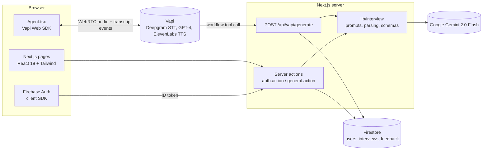
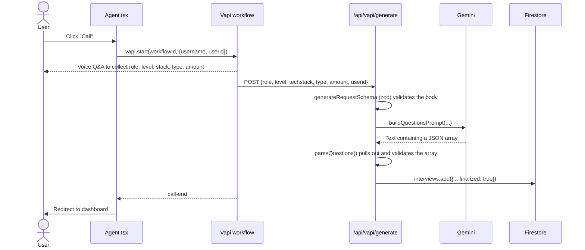
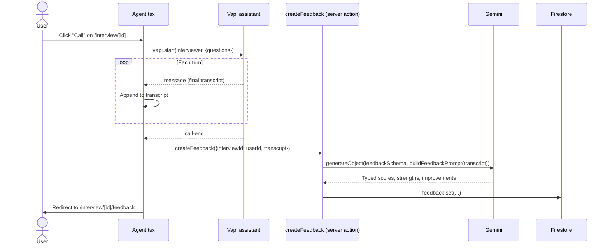

# Architecture

AI Voice Interviewer is a single Next.js 15 (App Router) app. There is no separate backend: server components and server actions talk to Firebase and Gemini directly, and the only HTTP endpoint is a webhook that Vapi calls during the "generate interview" voice workflow.

## System overview

## The two voice flows

### 1. Generate an interview

The user talks to a Vapi **workflow** (`NEXT_PUBLIC_VAPI_WORKFLOW_ID`) that asks for the role, level, tech stack, question mix and number of questions. When it has everything, the workflow calls our webhook.

### 2. Take an interview and get feedback

The interviewer assistant is defined inline in `constants/index.ts` (`interviewer`): Deepgram Nova-2 for speech-to-text, GPT-4 for the conversation and an ElevenLabs voice. The interview questions are injected through the `{{questions}}` template variable.

## Code layout

| Path | Responsibility |
|---|---|
| `app/(auth)` | Sign-in and sign-up pages. Redirects to `/` if already signed in. |
| `app/(root)` | Authenticated pages: dashboard, generate, interview, feedback. |
| `app/api/vapi/generate/route.ts` | Webhook for the Vapi workflow. Validates, generates questions and stores the interview. |
| `components/Agent.tsx` | Owns the Vapi call lifecycle (`INACTIVE → CONNECTING → ACTIVE → FINISHED`) and the live transcript. |
| `lib/interview/` | **Pure, unit-tested core logic**: prompt builders, LLM output parsing, request and feedback schemas. No I/O. |
| `lib/actions/` | Server actions for auth (session cookies) and Firestore reads and writes. |
| `lib/tech.ts` | Maps free-form tech names to devicon slugs. |
| `firebase/` | Client SDK (browser auth) and Admin SDK (server) initialization. |

Keeping prompts and parsing in `lib/interview` means the parts most likely to break (LLM output that isn't quite JSON, a renamed scoring category) are covered by fast tests without mocking Firebase, Vapi or Gemini.

## Auth

1. The browser signs in with the Firebase client SDK and gets an ID token.
2. The `signIn` server action exchanges it for a one-week, `httpOnly` Firebase **session cookie**.
3. Server components call `getCurrentUser()`, which verifies the cookie with the Admin SDK and loads the user's Firestore profile. The `(root)` layout redirects anonymous users to `/sign-in`.

## Data model (Firestore)

| Collection | Fields |
|---|---|
| `users` | `name`, `email` |
| `interviews` | `role`, `level`, `type`, `techstack[]`, `questions[]`, `userId`, `finalized`, `coverImage`, `createdAt` |
| `feedback` | `interviewId`, `userId`, `totalScore`, `categoryScores[5]`, `strengths[]`, `areasForImprovement[]`, `finalAssessment`, `createdAt` |

`getLatestInterviews` combines `orderBy(createdAt)` with `where(userId, "!=")`, so it needs a composite index in Firestore. The console prints a link to create it the first time the query runs.

## Known limitations

- `/api/vapi/generate` trusts the `userid` sent by the Vapi workflow. It should verify a shared secret header from Vapi before writing to Firestore.
- `next build` needs real Firebase Admin credentials, because the Admin SDK initializes at import time. CI therefore runs lint, typecheck and tests, not a full build.
